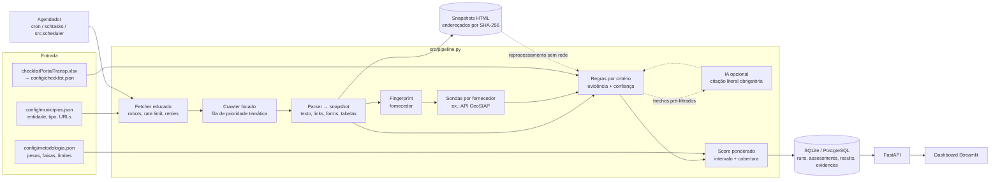

# Documentação técnica — Transparência Inteligente (MPRJ)

> Prova de conceito de uma **plataforma de monitoramento contínuo** da conformidade de portais públicos com o checklist de transparência. Este documento cobre os itens do entregável 2 do desafio. Os números de seção citados no código (ex.: "§6") referem-se a este arquivo.

## Sumário

1. [Problema](#1-problema)
2. [Arquitetura](#2-arquitetura)
3. [Abordagem](#3-abordagem)
4. [Tecnologias](#4-tecnologias)
5. [Metodologia de avaliação](#5-metodologia-de-avaliação)
6. [Metodologia de pontuação](#6-metodologia-de-pontuação)
7. [Tipos de entidade e critérios não aplicáveis](#7-tipos-de-entidade-e-critérios-não-aplicáveis)
8. [Escalabilidade](#8-escalabilidade)
9. [Tratamento de erros](#9-tratamento-de-erros)
10. [Estratégia de atualização e histórico](#10-estratégia-de-atualização-e-histórico)
11. [Inteligência artificial](#11-inteligência-artificial)
12. [Modelo de dados](#12-modelo-de-dados)
13. [API](#13-api)
14. [Dashboard](#14-dashboard)
15. [Limitações conhecidas](#15-limitações-conhecidas)
16. [Possibilidades de evolução](#16-possibilidades-de-evolução)
17. [Ética, segurança e LGPD](#17-ética-segurança-e-lgpd)

---

## 1. Problema

Hoje a avaliação é manual: uma pessoa navega no portal, procura cada item do checklist e marca "atende/não atende". Isso tem quatro problemas estruturais:

| Problema | Consequência | Como a solução responde |
|---|---|---|
| Custo linear por portal e por ciclo | Avaliar 5.000 portais todo mês é inviável | Coleta e avaliação automáticas, com custo marginal baixo por entidade (§8) |
| Resultado pontual | Um portal muda amanhã e a nota fica velha | Execuções periódicas, histórico imutável, diff entre execuções (§10) |
| Decisão pouco auditável | Difícil contestar ou revisar "não atende" | Toda decisão traz URL, trecho, hash do HTML e versão da regra (§5) |
| Ambiguidade | Nomenclaturas e fornecedores diferentes; páginas em JavaScript | Vocabulário temático, fingerprint de fornecedor, adaptadores de API e status `inconclusivo` explícito (§3, §5) |

Formulação técnica adotada: **dado o cadastro de uma entidade (tipo, município, URLs), produzir para cada critério aplicável do checklist um status entre `atende | parcial | nao_atende | inconclusivo`, com evidências verificáveis e grau de confiança, agregar em um score comparável e explicável, e repetir o processo periodicamente, guardando o histórico.**

O princípio que orienta todas as decisões: **ausência de evidência não é evidência de ausência.** O robô só afirma `nao_atende` quando a coleta foi suficiente para isso. Em qualquer outro caso, declara `inconclusivo` e deixa a incerteza visível no score.

## 2. Arquitetura



Camadas e responsabilidades:

| Camada | Módulo | Responsabilidade |
|---|---|---|
| Catálogo | `src/checklist.py` | Importa a planilha, herda fundamentação de células mescladas, define matriz, aplicabilidade, classificação e peso |
| Cadastro | `src/entities.py`, `config/municipios.json` | Entidades, tipo (informado ou inferido com confiança) |
| Acesso | `src/fetch.py` | HTTP com robots.txt, intervalo por domínio, backoff, limite de bytes, redirecionamento validado; renderização JS opcional |
| Coleta | `src/collector.py` | Descobre o portal na capa, prioriza links pelos temas do checklist, aplica circuit breaker |
| Extração | `src/page.py`, `src/themes.py` | Snapshot estruturado e classificação temática da página |
| Fornecedor | `src/fingerprint.py`, `src/adapters/` | Identifica tecnologia e usa APIs quando existem |
| Avaliação | `src/rules/`, `src/engine.py` | Uma função pura por critério; aplicabilidade; confiança mínima |
| IA | `src/ai/llm.py` | Juiz opcional para critérios semânticos, validado e com cache |
| Pontuação | `src/scoring.py` | Score ponderado, intervalo, cobertura, classificação |
| Persistência | `src/repository.py` | Histórico imutável, snapshots, diff, linha do tempo por critério |
| Exposição | `api/main.py`, `app/dashboard.py` | API REST somente leitura; painel que consome só a API |
| Orquestração | `src/pipeline.py`, `src/scheduler.py` | Execução paralela, reprocessamento, agendamento |

Decisão central: **separar coleta de avaliação.** O HTML de cada página é guardado (comprimido e endereçado por hash). Quando uma regra melhora, `python -m src.pipeline reevaluate --latest` reavalia todas as coletas sem tocar nos portais. Isso torna o sistema reproduzível (mesma coleta + mesma versão de regra = mesmo resultado) e barato de evoluir.

## 3. Abordagem

Foi escolhida uma **combinação** de técnicas. Cada uma entra onde é a mais barata e confiável para o problema:

| Técnica | Onde | Por quê |
|---|---|---|
| Crawler focado (best-first) | Navegação | Um BFS cego gasta o orçamento em notícias e galerias. A prioridade temática chega às páginas do checklist com cerca de 40 requisições |
| Regras determinísticas sobre o DOM | Maioria dos critérios | Baratas, explicáveis, reproduzíveis e testáveis. São a primeira linha |
| Vocabulário temático (`themes.py`) | Nomenclaturas diferentes | "Despesas", "Gastos", "Execução orçamentária" e "Empenhos" são tratados como o mesmo tema. É dado, não código |
| Fingerprint + adaptadores | Fornecedores de portal | Muitos municípios usam o mesmo fornecedor. Uma API estruturada (GeoSIAP) é mais confiável que HTML e um adaptador vale para todos os clientes do fornecedor |
| Renderização JS (Playwright) | Portais SPA | Opcional e acionada por configuração, porque custa de 10 a 50 vezes mais que HTTP simples. Gera screenshot como evidência visual |
| IA (LLM) | Interpretação de texto livre | Só onde a regra não decide e só com trechos pré-filtrados (§11) |

Por que não "mandar a página inteira para um LLM": seria caro (5.000 portais × 40 páginas), não reproduzível, sujeito a alucinação e difícil de auditar. Aqui a IA é um componente especializado, subordinado às regras e às evidências.

## 4. Tecnologias

| Tecnologia | Uso | Justificativa |
|---|---|---|
| Python 3.11+ | Todo o backend | Ecossistema de scraping, dados e IA |
| requests + BeautifulSoup | Coleta e parsing | Simples, robustos, sem navegador para a maioria dos portais |
| Playwright (opcional) | Páginas que dependem de JavaScript | Renderiza SPAs e tira screenshots |
| SQLite → PostgreSQL | Persistência | SQLite dispensa infraestrutura na POC. O esquema (SQL padrão, sem recursos exclusivos) migra para PostgreSQL |
| FastAPI | API | OpenAPI/Swagger automático, tipagem, testes com TestClient |
| Streamlit + Altair | Dashboard | Painel analítico rápido de construir que consome a API |
| openpyxl | Importação do checklist | Planilha original versionada como fonte de verdade |
| pytest | Testes | 66 testes, incluindo pipeline ponta a ponta offline |

## 5. Metodologia de avaliação

### 5.1 Status

| Status | Significado | Entra no score? |
|---|---|---|
| `atende` | Evidência positiva suficiente | Sim (valor 1) |
| `parcial` | Evidência de atendimento incompleto (ex.: falta uma coluna, só PDF) | Sim (valor 0,5) |
| `nao_atende` | Coleta suficiente **e** nada encontrado nas páginas relevantes, ou evidência de descumprimento (ex.: e-SIC exige motivo do pedido) | Sim (valor 0) |
| `inconclusivo` | O robô não conseguiu decidir: falha de acesso, conteúdo dinâmico, confiança abaixo do mínimo, divergência regra × IA | Não. Aparece no intervalo e na cobertura |
| `nao_aplicavel` | Critério de outra matriz (ex.: LOA para Câmara) | Não, e não reduz cobertura |
| `nao_avaliado` | Aplicável, mas ainda sem regra automatizada | Não. Reduz a "cobertura do checklist" |

### 5.2 Quando o robô pode dizer "não atende"

`src/rules/base.py::absence` centraliza essa decisão:

1. **Coleta insuficiente** (capa inacessível, menos de 10 páginas válidas, coleta abortada ou portal identificado mas não alcançado) → `inconclusivo`, confiança 0,3.
2. **Páginas relevantes dependem de JavaScript** (muito script e pouco texto) e não houve renderização → `inconclusivo`, com a recomendação de ativar `MPRJ_RENDER_JS=1`.
3. **Área de conteúdo do portal não alcançada.** Para critérios cujo conteúdo fica no portal (receita, despesa, gestão fiscal, instrumentos de planejamento, e-SIC, dados abertos), o robô só afirma ausência se tiver alcançado ao menos uma página de receita, despesa ou planejamento. Caso contrário → `inconclusivo`. Essa regra veio da validação manual: em Japeri, o portal GeoSIAP é montado por JavaScript, o robô leu 37 páginas só do site institucional e declarou "não atende" para receita, despesa, RGF e LOA, que existem (a API do portal retorna os dados). Eram falsos "não atende", o erro mais grave numa fiscalização.
4. **Busca não esgotada.** Se a coleta parou pelo limite de páginas com links do tema do critério ainda na fila (ex.: "Gestão Fiscal" para RGF, LOA, RREO), → `inconclusivo`, com a sugestão de aumentar `max_paginas`. Em Japeri, depois de corrigida a navegação por rotas, as 40 páginas foram gastas nas seções de receita e despesa, e o robô passou a afirmar "não atende" para PPA, LDO, LOA e RREO sem ter visitado a área de planejamento.
5. Fora desses casos → `nao_atende`, com confiança moderada (0,55 a 0,7). As páginas examinadas ficam registradas como evidência de ausência.

### 5.3 Evidências

Cada resultado guarda uma lista de evidências tipadas (`pagina`, `link`, `formulario`, `tabela`, `documento`, `texto`, `controle`, `api`, `ausencia`, `ia`) com URL, título da página, trecho literal e detalhes (cabeçalhos da tabela, formato do arquivo, data mais recente encontrada, campos do formulário, screenshot…). As páginas de onde as evidências vieram têm **SHA-256 do HTML original** e snapshot comprimido. Com isso, um avaliador humano pode abrir o trecho exato que o robô viu, mesmo que o portal já tenha mudado.

### 5.4 Confiança

A confiança é atribuída **pela regra**, de acordo com a força da evidência. Exemplos:

- tabela com as três fases da despesa: 0,9;
- link "Fale Conosco" sem formulário verificado: 0,7;
- ausência após coleta suficiente: 0,6;
- datas extraídas do texto: 0,75.

Resultados com confiança abaixo de `confianca_minima` (0,5) são rebaixados para `inconclusivo`, com o status original anotado no texto. A confiança **não multiplica o score**: misturar "quão bom é o portal" com "quão seguro está o robô" tornaria o número inexplicável. A incerteza aparece separadamente, no intervalo e na cobertura.

Os valores atuais de confiança são heurísticos. A calibração correta é empírica: em cada ciclo, avaliadores humanos revisam uma amostra e mede-se a precisão observada por regra e por faixa de confiança. O campo `needs_review` já marca os casos prioritários para essa revisão.

### 5.5 Validação dos resultados (robô × avaliador humano)

A qualidade das regras é medida contra conferência humana, não presumida. O comando abaixo exporta a última coleta de cada entidade para uma planilha:

```cmd
python -m src.validacao --saida data\validacao.xlsx
```

A planilha traz só os critérios aplicáveis e automatizados, com o status, a confiança, a conclusão e a evidência do robô já preenchidos. O avaliador confere cada linha no portal e registra o status que encontrou e, se discordar, a causa da divergência. A aba **Métricas** calcula por fórmulas:

| Métrica | Por que importa |
|---|---|
| Concordância exata e **kappa de Cohen** | Acerto geral e acerto além do acaso, nos pares em que robô e humano concluíram |
| **Falsos "não atende"** e precisão do "não atende" | É o erro mais grave numa fiscalização: acusar ausência de informação que existe |
| Falsos "atende" e precisão do "atende" | Indício aceito como suficiente sem ser |
| Taxa de inconclusivos e inconclusivos resolvidos pelo humano | Cobertura e ganho potencial com renderização JS ou regras novas |
| Quebra por critério e por entidade | Indica qual regra ajustar primeiro |
| Matriz de confusão robô × humano | Mostra o padrão dos erros |

Depois de um ajuste, `python -m src.validacao --anterior data\validacao.xlsx --saida data\validacao_depois.xlsx` gera a nova planilha **reaproveitando as respostas humanas** (o portal não mudou, só o robô). As linhas em que o robô mudou de status ficam destacadas, e as métricas do "depois" saem sem refazer a conferência.

O ciclo é: conferir → ajustar a regra (registrando na aba **Ajustes**) → `python -m src.pipeline reevaluate --latest` (sem acessar os portais) → exportar de novo e comparar. Os resultados dessa validação devem ser reportados junto com o score, e calibram os valores de confiança (§5.4).

### 5.6 Data de referência

Critérios temporais (ex.: 4.6) comparam com a **data da coleta**, não com "hoje". Reprocessar uma coleta antiga no futuro produz o mesmo resultado.

## 6. Metodologia de pontuação

### 6.1 Fórmula

```
score      = 100 × Σ(peso_i × valor_i) / Σ(peso_i)        i ∈ critérios aplicáveis e conclusivos
mínimo     = 100 × Σ(peso × valor) / Σ(peso avaliado)      inconclusivos contados como 0
máximo     = 100 × (Σ(peso × valor) + Σ(peso inconcl.)) / Σ(peso avaliado)   inconclusivos contados como 1
cobertura da avaliação = peso conclusivo / peso avaliado
cobertura do checklist = peso avaliado / peso aplicável
```

Valores: `atende = 1`, `parcial = 0,5`, `nao_atende = 0`.

Pesos por classificação: **essencial = 3, obrigatória = 2, recomendada = 1**, inspirados na lógica essencial/obrigatória/recomendada do Programa Nacional de Transparência Pública (Atricon). A classificação de cada critério está em `config/checklist.json` e os pesos em `config/metodologia.json`. Os dois são configuráveis sem mudar código, inclusive com peso individual por critério (`pesos_por_criterio`).

### 6.2 Por que não uma média aritmética simples

Exemplo com dez critérios avaliados para duas entidades fictícias:

| | A | B |
|---|---|---|
| Atende | 2.4, 2.5, 2.6, 16.2, 16.3, 18.1 (endereço, telefone, horário, contraste, fonte, LGPD) | 4.1, 3.1, 12.1, 15.1 (despesa, receita, RGF, e-SIC) |
| Não atende | 4.1, 3.1, 12.1, 15.1 | os seis acima |
| Média simples | **60,0** | **40,0** |
| Score ponderado | **47,8** | **52,2** |

Pela média simples, A parece mais transparente. Mas A não publica despesa, receita, RGF nem e-SIC, o núcleo da LC 101 e da LAI. A média simples premia o que é barato de cumprir (um número de telefone) tanto quanto o que é caro e essencial (execução orçamentária). Esse teste existe em `tests/test_scoring.py`, e a API devolve as duas medidas (`media_simples` e `score`) para que a diferença seja visível.

Outros problemas da média simples que a metodologia trata:

- **Critérios não aplicáveis** contados como "não atende" penalizam injustamente uma Câmara por não publicar LOA. Aqui eles saem do denominador.
- **Falhas do robô** contadas como "não atende" transformam instabilidade do site ou do crawler em nota baixa. Aqui viram `inconclusivo`, excluído do score e exposto no intervalo.
- **Granularidade desigual**: a despesa tem 13 subitens e o RGF tem 4. Peso por classificação reduz, mas não elimina, esse efeito. Uma evolução possível é normalizar por categoria (média das categorias) e reportar os dois (§16).

### 6.3 Classificação

Faixas configuráveis: **Elevado ≥ 85, Intermediário ≥ 60, Básico ≥ 30, Inicial > 0, Inexistente = 0.** A faixa Elevado **exige todos os critérios essenciais avaliados em `atende`**. Uma entidade com 90 pontos e despesa em `parcial` é rebaixada para Intermediário. Isso impede que muitos itens acessórios compensem a falta de um essencial.

### 6.4 Comparabilidade

- Com **cobertura da avaliação abaixo de 50%** (`cobertura_minima_para_score`), não se publica score pontual: a classificação é "Cobertura insuficiente" e só o intervalo é exibido. Na primeira execução real, Duque de Caxias apareceu com 100% calculado sobre 5% de cobertura, porque um único critério foi decidido. Essa regra foi criada a partir desse caso. O limite começou em 30% e subiu para 50% quando Itaboraí, na execução seguinte, recebeu 89,5% com intervalo de 27% a 97% e cobertura de 30%: um número que não informava nada.
- O ranking só compara entidades com **cobertura da avaliação ≥ 60%** (`cobertura_minima_para_ranking`). As demais aparecem com aviso.
- Cada avaliação grava `methodology_version` e `checklist_version`. Mudou peso ou regra: as avaliações antigas são **reprocessadas** a partir dos snapshots, para manter a série comparável.
- O score é sempre publicado com intervalo e cobertura. "62% (55–71%, cobertura 80%)" é honesto. "62%" sozinho não é.

## 7. Tipos de entidade e critérios não aplicáveis

1. **Identificar o tipo.** O cadastro informa `tipo`. Se não informar, `src/entities.py::infer_entity_type` aplica regras ordenadas sobre nome e domínio (ex.: `camara`/`.leg.br` → legislativo municipal, `prefeitura` → executivo municipal). Cada regra tem confiança, e abaixo de 0,8 a inferência é marcada `requer_confirmacao`. Sem tipo confirmado, só a matriz comum é avaliada e as matrizes específicas ficam `nao_avaliado`.
2. **Determinar aplicabilidade.** Na importação da planilha, cada critério recebe `aplicavel_a`. A matriz comum vale para todos os tipos. A matriz do Poder Executivo vale para `executivo_municipal`/`executivo_estadual`. Itens marcados "(Executivo Municipal)" no texto (21.1, 21.3) valem só para municípios.
3. **Tratar não aplicáveis.** O motor gera `nao_aplicavel` com a justificativa ("Critério da matriz 'poder_executivo' não se aplica a entidades do tipo 'legislativo_municipal'"). Esses critérios ficam fora do numerador e do denominador, sem penalidade. A demonstração inclui uma Câmara Municipal para exercitar esse caminho.
4. **Inexistência legítima.** Alguns itens podem não existir de fato: obras paralisadas (11.4), emendas parlamentares (13.x), transferências (3.8–3.12, 4.8–4.13), informações desclassificadas (15.6–15.7). Estão marcados `pode_ser_inexistente` no catálogo. A regra para esses casos (a implementar junto com os critérios) é aceitar `nao_aplicavel` **somente com declaração negativa encontrada no portal**, com a declaração como evidência. Nunca por simples omissão.
5. **Novos tipos.** Uma matriz para Câmaras ou Tribunais entra como novas linhas na planilha, com outro marcador de seção. O importador atribui a aplicabilidade e o restante do sistema não muda.

## 8. Escalabilidade

> Pergunta central do desafio: 5.000 portais por mês, de forma confiável, explicável e economicamente viável?

### 8.1 Ordem de grandeza

| Item | Estimativa |
|---|---|
| Páginas por entidade | ≈ 40 (limite configurável) |
| Requisições por mês | 5.000 × 40 = 200 mil |
| Tempo com 1 req/s por domínio e 50 domínios em paralelo | ≈ 200.000 / 50 ≈ 1,1 h de rede, mais a latência. Algumas horas num worker modesto |
| Armazenamento | HTML comprimido de ≈ 20–40 KB por página → poucos GB por ciclo. Páginas inalteradas não são regravadas (endereçamento por conteúdo) |
| IA | Só para critérios semânticos indecisos: ≤ 3 chamadas por entidade, ~2 mil tokens cada, com teto por execução e cache por hash do prompt. Na ordem de dezenas de milhões de tokens por mês com modelo pequeno |

O custo é dominado pela rede e é linear no número de entidades. Não há componente quadrático nem dependência de IA para a maioria dos critérios.

### 8.2 Da POC para produção

| Tema | POC (implementado) | Produção (proposto) |
|---|---|---|
| Múltiplas análises | `ThreadPoolExecutor` por entidade; escrita serial no banco | Uma tarefa por entidade numa fila (Celery/RQ + Redis, ou SQS); workers horizontais |
| Processamento assíncrono | Coleta (I/O) em paralelo, avaliação em seguida | Estágios separados em filas: coleta → extração → avaliação. Cada um escala por conta própria |
| Filas e prioridade | — | Prioridade por "dias desde a última avaliação" e por mudança detectada |
| Limites de requisição | Intervalo mínimo por domínio (thread-safe), robots.txt, backoff, `Retry-After` | Token bucket por domínio compartilhado entre workers (Redis), janela noturna |
| Sites indisponíveis | Circuit breaker (5 falhas seguidas abortam a coleta); resultado `inconclusivo` | Nova tentativa agendada em horas; alerta após N ciclos indisponíveis |
| Páginas muito grandes | Corte em 3 MB, marcado `truncated`; parse limitado | Streaming e extração de tabelas por paginação da API |
| Conteúdo dinâmico | Detecção de SPA → `inconclusivo`; Playwright opcional | Pool de navegadores separado, acionado só para domínios marcados como dinâmicos |
| Fornecedores diferentes | Fingerprint de 16 assinaturas; adaptador GeoSIAP | Biblioteca de adaptadores por fornecedor; painel de quebra por fornecedor (layout mudou → vários municípios caem juntos) |
| Reprocessamento | `reevaluate` a partir de snapshots, idempotente | O mesmo, em lote, disparado por nova versão de regra |
| Custos | Orçamento de páginas por entidade; IA com teto e cache | Recoleta incremental: `ETag`/`Last-Modified` e hash, reavaliando só o que mudou |
| Banco | SQLite | PostgreSQL (o mesmo esquema), snapshots em armazenamento de objetos (S3/MinIO) |

## 9. Tratamento de erros

| Situação | Comportamento |
|---|---|
| DNS, timeout, conexão recusada | Nova tentativa com backoff exponencial; erro registrado em `pages`/`errors`; critérios dependentes → `inconclusivo` |
| HTTP 429 / 503 (limite de acesso, firewall) | **Não insiste**: no máximo uma nova tentativa, e só se o servidor informar `Retry-After` ≤ 30 s. A coleta da entidade é interrompida na hora (sem sitemap nem outras páginas), e os critérios ficam `inconclusivo` até a próxima execução |
| HTTP 500/502/504 | Erro transitório: nova tentativa com backoff exponencial; depois, falha registrada |
| HTTP 404 em link interno | Registrado, sem contar para o circuit breaker (link quebrado é dado, não instabilidade) |
| robots.txt proíbe | Página não acessada (`bloqueado_por_robots_txt`); critério → `inconclusivo` |
| Redirecionamento para endereço interno ou privado | Bloqueado (proteção contra SSRF) |
| Conteúdo não HTML, acima do limite, JS não renderizado | Registrado; regras retornam `inconclusivo` |
| Exceção dentro de uma regra | Capturada pelo motor; só aquele critério vira `inconclusivo`, com traceback guardado |
| Falha de uma entidade | Não interrompe a execução das outras (testado) |
| Falha da IA ou resposta inválida | Descartada; mantém-se o resultado da regra |
| Falha de sonda de API | Registrada em `sondas`; avaliação segue pelo HTML |

## 10. Estratégia de atualização e histórico

- **Agendamento.** `src/scheduler.py` (processo residente) ou o agendador do sistema operacional, com exemplos de `schtasks` (Windows) e `cron` (Linux) no módulo. O padrão sugerido é mensal, conforme o desafio. Cada execução gera uma linha em `runs`.
- **Histórico imutável.** Cada coleta gera um novo `assessment`. Nada é sobrescrito. Reprocessamentos são `assessments` do tipo `reprocessamento` que apontam para a coleta de origem.
- **Perguntas que o sistema responde:**

| Pergunta | Onde |
|---|---|
| O portal melhorou ou piorou? | `GET /entities/{id}/evaluations/history` (série com intervalo e cobertura) |
| Quais critérios foram corrigidos? | `GET /entities/{id}/evaluations/diff` → `melhoraram` |
| Quais continuam pendentes? | `diff` → `pendentes`; `GET /entities/{id}/criteria?status=nao_atende` |
| Quando uma conformidade foi identificada? | Campo `atende_desde` em `GET /entities/{id}/criteria` |
| Evolução de um critério | `GET /entities/{id}/criteria/{criterio}/history` |
| O portal mudou de endereço ou fornecedor? | `portal_url`, `portal_source` e `vendors` em cada avaliação |

- **Escopo de navegação.** O crawler segue links de todo o domínio institucional da prefeitura (ex.: `duquedecaxias.rj.gov.br` e qualquer subdomínio, como `portal.`, `transparencia.`, `esic.`). Portais hospedados em domínio de fornecedor (ex.: `japeri.geosiap.net.br`) são seguidos só pelo host exato, para não entrar no portal de outro município do mesmo fornecedor. Esse ajuste também veio da primeira execução real: Duque de Caxias e Itaboraí tinham o cadastro em subdomínio (`portal.`, `site.ib.`) e o robô descartava os demais subdomínios da própria prefeitura.
- **Renderização seletiva.** Com `render_js`, o Playwright é usado só na capa (que ganha screenshot como evidência) e em páginas cujo HTML estático tem menos de 15 links. As demais seguem por HTTP simples, o que mantém o custo próximo da coleta sem navegador. Duque de Caxias (capa com 0 links no HTML) e Itaboraí (29 links) estão configurados assim.
- **Portal fora da capa.** Se a capa não tem link para o portal, o robô procura em todas as páginas já coletadas, pontuando o rótulo "transparência" e links para fornecedores de portal conhecidos (Agili, Betha, IPM, Fiorilli, GeoSIAP…). O portal achado é registrado como `descoberto_no_site` ou `descoberto_via_sitemap`.
- **Rotas de SPA.** Portais como o GeoSIAP navegam por rotas no fragmento da URL (`#/despesas`). O robô preserva essas rotas (descartando só âncoras comuns, como `#topo`) e as renderiza. Antes desse ajuste, todos os links do menu do portal de Japeri colapsavam na mesma URL, e o robô nunca chegava às seções de receita e despesa. As receitas e despesas de Japeri apareciam como `atende` apenas pela API do GeoSIAP.
- **Plano B por sitemap.** Se a navegação pela capa não alcança 10 páginas válidas (menu montado por JavaScript, poucos links no HTML), o robô lê os sitemaps do site (`Sitemap:` do robots.txt, `/sitemap.xml`, `/wp-sitemap.xml`) e prioriza as URLs com temas do checklist. Descarta as que parecem notícias (título longo ou data/número no caminho), favorece caminhos curtos e limita a 3 URLs por tema. Em Itaboraí, o sitemap tem 8.733 URLs, e sem esse filtro o orçamento foi gasto em cerca de 30 avisos de licitação quase iguais. Capas com menos de 40 links geram um aviso sugerindo `render_js: true` para a entidade no cadastro. As decisões ficam registradas nas notas da coleta (`python -m src.pipeline diagnostico`).
- **Mudança de endereço.** Se o portal não está cadastrado, o crawler o descobre pelo link "Transparência" da capa (`portal_source = descoberto_na_capa`). Assim, uma troca de endereço é absorvida e registrada.

## 11. Inteligência artificial

Opcional e desligada por padrão. É ativada com as variáveis `MPRJ_LLM_PROVIDER`, `MPRJ_LLM_MODEL` e a chave do provedor.

| Pergunta do desafio | Resposta |
|---|---|
| Qual problema resolve? | Critérios que exigem ler texto livre. Ex.: 15.2, em que o e-SIC exige documentos, firma, declaração ou motivo, ou 18.1, em que a página identifica o encarregado da LGPD com contato. Regex não distingue "não é necessário enviar documentos" de "é necessário enviar documentos" com segurança |
| Por que é necessária? | Só nesses casos. Os outros 23 critérios são decididos por regras. O modelo está restrito a 3 critérios (15.2, 18.1, 2.1) |
| Estratégia | Regras pré-filtram até 6 trechos relevantes (≤ 1.500 caracteres cada). Pergunta fechada sobre **um** critério. Temperatura 0. Saída em JSON (status, confiança, justificativa, citação, url) |
| Validação | JSON bem-formado, status conhecido, confiança entre 0 e 1 e **citação literal presente nos trechos enviados**. Citação inventada ou parafraseada leva ao descarte (teste em `tests/test_llm.py`) |
| Falsos positivos e negativos | A IA só atua quando a regra é `inconclusivo` ou para confirmar uma negativa. Confiança da IA limitada a 0,75. Resultado com IA sempre marcado `needs_review`. Revisão humana amostral mede a precisão por critério |
| Respostas inconsistentes | Divergência entre regra e IA vira `inconclusivo` + revisão humana. Resposta `inconclusivo` da IA é ignorada |
| Controle de custo | Só critérios semânticos, só trechos, teto `MPRJ_LLM_MAX_CALLS` por execução, cache em disco por hash do prompt (reprocessar não custa nada) |
| Rastreabilidade | Evidência do tipo `ia` com modelo, `prompt_sha256` e citação. Log de eventos (aceito, descartado, erro, orçamento esgotado) em `ia_log` da avaliação |

## 12. Modelo de dados

```mermaid
erDiagram
  entities ||--o{ assessments : tem
  runs ||--o{ assessments : agrupa
  assessments ||--o{ pages : coletou
  assessments ||--o{ results : avaliou
  results ||--o{ evidences : justifica
  criteria ||--o{ results : "define (por versão)"
  assessments ||--o| assessments : "reprocessa"
  entities { int id; text name; text slug; text tipo; text municipio; text site; text portal }
  runs { int id; text trigger; text started_at; text methodology_version; text checklist_version }
  assessments { int id; text kind; text collected_at; text collection_status; real score; real score_min; real score_max; real cobertura_avaliacao; text classificacao; json health; json vendors }
  pages { int id; text url; int status; text sha256; text snapshot_path; json themes }
  results { int id; text criterion_id; text status; real confidence; text finding; text method; text rule_version; bool needs_review }
  evidences { int id; text kind; text url; text title; text snippet; json detail }
  criteria { text id; text checklist_version; text classificacao; json aplicavel_a; bool implementado; text complexidade }
```

As tabelas das etapas exploratórias anteriores (`evaluations`, `criteria_results`, `evidence_candidates`, `geosiap_evidence`) foram mantidas para rastreabilidade e continuam acessíveis pela API (`/legacy/...` e `/geosiap/...`).

## 13. API

Somente leitura. Documentação interativa em `http://127.0.0.1:8000/docs`.

| Método e rota | Retorno |
|---|---|
| `GET /health` | Status e total de avaliações |
| `GET /overview` | Entidades avaliadas, score médio, melhor/pior (só comparáveis), ranking, distribuição, critérios por status, média por categoria |
| `GET /entities` | Entidades com score, classificação e cobertura da última avaliação |
| `GET /entities/{id}` | Cadastro da entidade |
| `GET /entities/{id}/evaluations/latest` | Última avaliação completa: score, intervalo, categorias, saúde da coleta, fornecedor, critérios e evidências (`?evidencias=false` para versão leve) |
| `GET /entities/{id}/evaluations/history` | Série histórica |
| `GET /entities/{id}/evaluations/diff?de=&para=` | Melhoraram / pioraram / pendentes |
| `GET /entities/{id}/evaluations/{assessment_id}` | Avaliação específica |
| `GET /entities/{id}/criteria?status=` | Situação atual por critério, com `atende_desde` |
| `GET /entities/{id}/criteria/{criterio}/history` | Linha do tempo de um critério |
| `GET /criteria?implementado=` | Catálogo com aplicabilidade e metadados da regra |
| `GET /runs` | Execuções (agendadas, manuais, reprocessamentos) |
| `GET /geosiap/evidences[/{id}]` | Evidências estruturadas GeoSIAP (etapas 8–9) |

Justificativa: a API não dispara coletas. Coletar é trabalho longo, que pertence ao agendador e à fila. Assim, a API é barata, cacheável e segura para exposição pública.

## 14. Dashboard

`app/dashboard.py` consome **somente** a API (pode rodar em outra máquina via `MPRJ_API_URL`). Três abas:

- **Visão geral:** entidades avaliadas, score médio, melhor e pior, critérios atendidos/não atendidos, ranking com aviso de baixa cobertura, distribuição dos scores e média por categoria.
- **Por entidade:** score, classificação, intervalo, coberturas, essenciais pendentes, evolução histórica (linha do score com faixa do intervalo, e a sequência "62% → 68% → 74%"), corrigidos/pioraram/pendentes, melhores e piores categorias, critérios filtráveis por status com evidências clicáveis, e evidências GeoSIAP.
- **Checklist e cobertura:** os 142 critérios, quais são automatizados, com complexidade e técnica.

Status sempre com ícone e rótulo, nunca só cor. Tema escuro em `.streamlit/config.toml`.

## 15. Limitações conhecidas

- **Cobertura do checklist.** São 27 de 142 critérios (≈ 22% do peso aplicável a uma prefeitura). O score é publicado junto com essa cobertura, e a arquitetura generaliza (§ `CRITERIOS.md`).
- **Ausência é inferência.** Um item fora das ~40 páginas visitadas, atrás de formulário de consulta ou em sistema externo pode gerar falso `nao_atende`. A mitigação está na confiança moderada, no `needs_review`, no orçamento de páginas configurável e na revisão amostral.
- **Conteúdo dinâmico.** Sem `MPRJ_RENDER_JS=1`, portais SPA tendem a `inconclusivo`. Consultas que exigem preencher filtros e submeter não são executadas (o robô não submete formulários).
- **Documentos.** PDFs são identificados por rótulo, URL e formato, não pelo conteúdo. O robô não verifica se o arquivo "RGF" é de fato um RGF nem o período que cobre. A evolução natural é extrair texto do PDF e validar o cabeçalho.
- **Datas (4.6).** A data mais recente no texto da página de despesas é uma aproximação da atualização. Datas de vigência ou de publicação de normas podem confundir.
- **Visibilidade na capa (1.2).** Sem renderização, verifica-se a existência do link, não o destaque visual.
- **Pesos e limites** (pesos 3/2/1, 7/45 dias, faixas) são propostas defensáveis, mas precisam de validação com especialistas do GATE/MPRJ. Estão em configuração justamente por isso.
- **Confiança heurística**, ainda não calibrada contra avaliação humana (§5.4).
- **Validação real.** Os testes automatizados usam um portal sintético (`src/demo.py`) e HTML controlado. A execução contra os sete municípios deve ser feita no ambiente do avaliador (`python -m src.pipeline run`), e as primeiras execuções precisam de revisão manual das evidências, com a planilha de validação (§5.5).
- **Bloqueio por firewall.** Em 15/10/2026, o firewall do site de Itaboraí (Wordfence) bloqueou o IP do avaliador depois de execuções seguidas: capa, sitemap e cerca de 40 páginas em menos de uma hora, com intervalo de 1 s. A versão então vigente insistia 3 vezes em respostas 503. Correções: parar ao primeiro sinal de limite, intervalo e número máximo de páginas configuráveis por entidade (Itaboraí: 5 s e 25 páginas) e nunca contornar o bloqueio. Em produção, o mesmo vale com mais força: token bucket por domínio, janelas noturnas e IP institucional identificado, com contato publicado.
- **Assinaturas de fornecedor** são padrões textuais e podem gerar falso positivo. A primeira versão marcava "Agili" em qualquer texto com "agilidade"; hoje as assinaturas exigem palavra inteira ou domínio.
- **Domínios oficiais** de Niterói e Maricá estão cadastrados como inativos até confirmação.

## 16. Possibilidades de evolução

1. **Mais critérios por reaproveitamento.** Os helpers de formatos, atualização, histórico e documentos cobrem dezenas de itens análogos (pessoal, diárias, licitações, contratos).
2. **Revisão humana integrada.** Endpoint `POST /results/{id}/review`. A decisão humana prevalece no score e alimenta a calibração da confiança e um conjunto rotulado.
3. **Classificador supervisionado de páginas** treinado nas revisões, substituindo parte do vocabulário temático.
4. **Extração de PDFs e planilhas** (pdfplumber/pandas) para validar conteúdo, período e completude.
5. **Recoleta incremental** com `ETag`/hash e alertas de mudança (novo fornecedor, critério regrediu).
6. **Score por categoria normalizado** e índice de evolução (tendência), além do score absoluto.
7. **Filas e workers** (§8.2), PostgreSQL e armazenamento de objetos.
8. **Relatório por entidade** em PDF para encaminhamento institucional, com as evidências e screenshots.
9. **Portal público** de acompanhamento, consumindo a mesma API.

## 17. Ética, segurança e LGPD

- User-Agent identificado, robots.txt respeitado, intervalo entre requisições por domínio, sem contornar autenticação ou CAPTCHA, sem submeter formulários.
- Bloqueio de URLs e redirecionamentos para endereços internos.
- Os resumos GeoSIAP não armazenam registros individuais nem nomes de credores (etapas 8–9). Os snapshots HTML ficam em `data/`, que não é versionada (`.gitignore`).
- Resultados são **indicadores técnicos de conformidade** que apoiam, e não substituem, a análise jurídica do MPRJ. Todo `nao_atende` traz as evidências que permitem contestá-lo.
